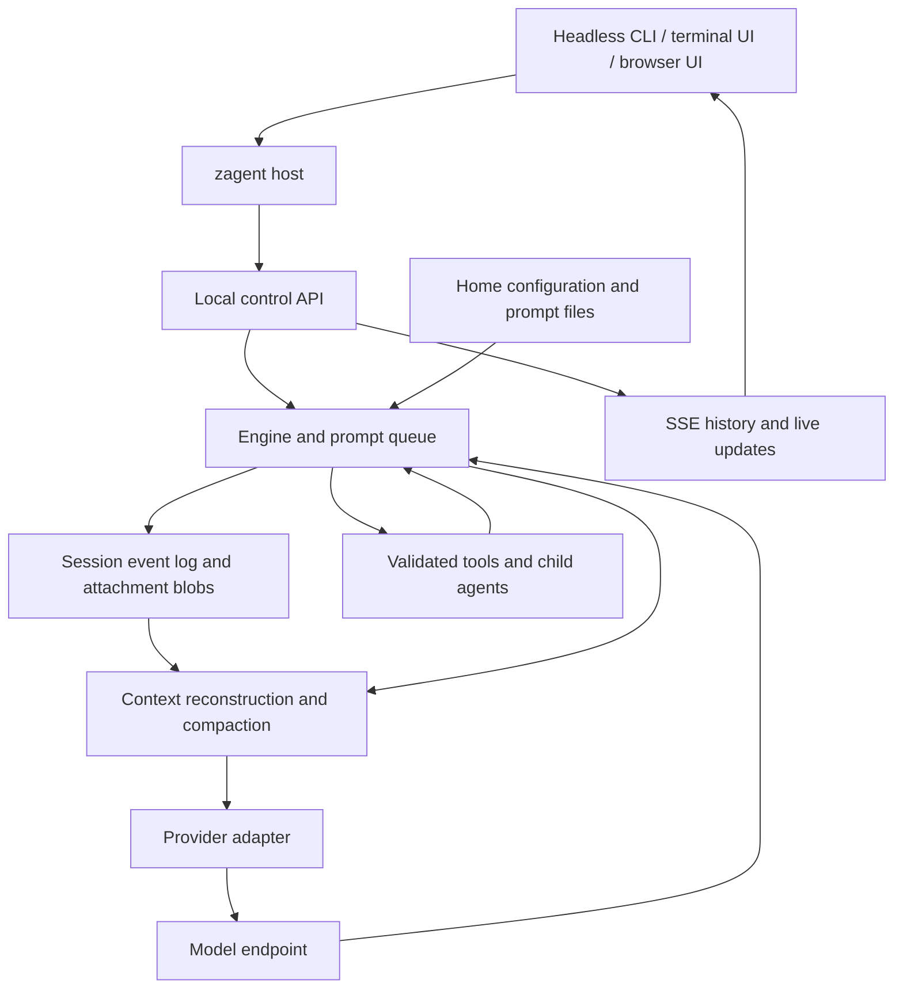
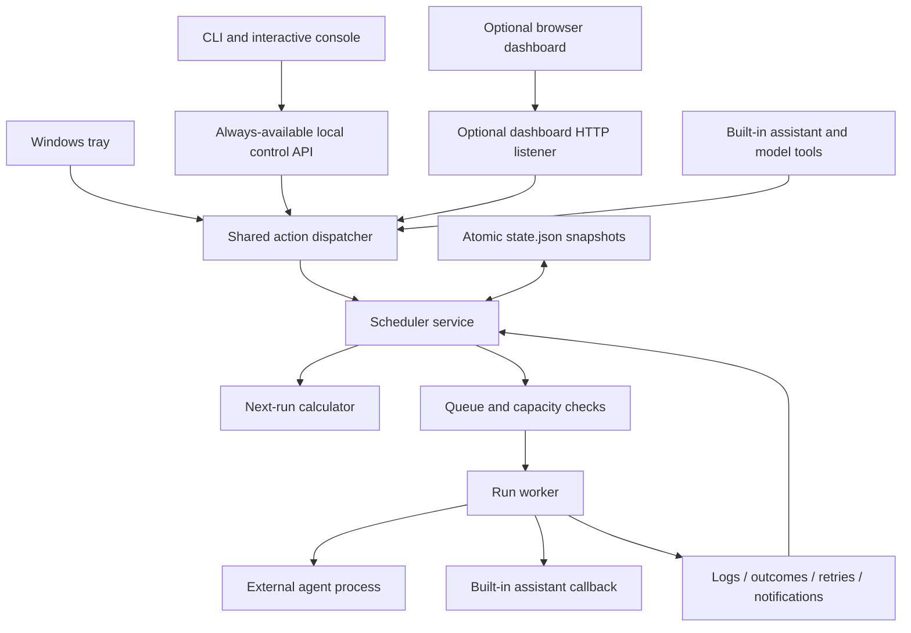

# ZGravity: complete project structure and architecture

Inspected 12 October 2026. This document describes the current source, not proposed features. Runtime examples show layouts; credentials, prompts, conversations and access tokens were not read for this inventory.

## Project relationship

`zengine` is the Go agent runtime. Its executable is named `zagent`. It runs model conversations, invokes tools, manages context and saves sessions. `zsched` is the Go scheduler and process supervisor. It registers agents, saves schedules, decides when work is due, launches compatible agent binaries, tracks results and presents controls.

The projects are independent Go modules. zsched does not import zengine. They integrate through command-line arguments, a task file, process exit status and standard output/error. Their model settings, locks and state stores are separate. Multiple registered agents can share the same executable while using distinct homes/workspaces.

## Complete zengine source tree

Build output is described separately below. All source, tests, examples, documentation and root release files appear here.

```text
zengine/
├── cmd/
│   └── zagent/
│       ├── args.go
│       ├── args_test.go
│       ├── cmds.go
│       ├── host.go
│       ├── main.go
│       ├── proc_unix.go
│       ├── proc_windows.go
│       ├── run.go
│       ├── term.go
│       ├── toolcmd.go
│       ├── toolcmd_test.go
│       ├── tui.go
│       └── ui.go
├── docs/
│   ├── ARCHITECTURE.md
│   ├── CONFIG.md
│   ├── CONTROL_API.md
│   ├── CUSTOMIZING.md
│   ├── DEVELOPMENT.md
│   ├── EXTERNAL_TOOLS.md
│   ├── INSTALL.md
│   ├── PROJECT_ANALYSIS.md
│   ├── PROJECT_STRUCTURE_AND_ARCHITECTURE.md
│   ├── PROVIDERS.md
│   ├── README.md
│   ├── RELEASING.md
│   └── TOOL_DEVELOPER_GUIDE.md
├── examples/
│   └── tools/
│       ├── hello_node/
│       │   ├── hello.js
│       │   └── hello_node.json
│       ├── hello_powershell/
│       │   ├── hello.ps1
│       │   └── hello_powershell.json
│       ├── image_maker/
│       │   ├── image_maker.json
│       │   └── image_maker.py
│       ├── slow_report/
│       │   ├── slow_report.json
│       │   └── slow_report.py
│       └── word_count/
│           ├── word_count.json
│           └── word_count.py
├── internal/
│   ├── config/
│   │   ├── config.go
│   │   ├── config_test.go
│   │   ├── dotenv.go
│   │   └── home.go
│   ├── contextmgr/
│   │   ├── build.go
│   │   ├── compact.go
│   │   ├── contextmgr_test.go
│   │   ├── policy.go
│   │   └── repair.go
│   ├── control/
│   │   ├── api.go
│   │   ├── client.go
│   │   ├── control_test.go
│   │   └── server.go
│   ├── engine/
│   │   ├── call.go
│   │   ├── commands.go
│   │   ├── commands_test.go
│   │   ├── context_test.go
│   │   ├── engine.go
│   │   ├── engine_test.go
│   │   ├── harness_test.go
│   │   ├── jitter.go
│   │   ├── live.go
│   │   ├── model.go
│   │   ├── prepare.go
│   │   ├── subagent.go
│   │   ├── subagent_test.go
│   │   └── turn.go
│   ├── llm/
│   │   ├── schema.go
│   │   ├── schema_test.go
│   │   └── types.go
│   ├── prompt/
│   │   ├── prompt.go
│   │   └── prompt_test.go
│   ├── provider/
│   │   ├── anthropic.go
│   │   ├── common.go
│   │   ├── factory.go
│   │   ├── gemini.go
│   │   ├── live_test.go
│   │   ├── openai.go
│   │   ├── provider.go
│   │   └── provider_test.go
│   ├── render/
│   │   ├── transcript.go
│   │   └── transcript_test.go
│   ├── session/
│   │   ├── event.go
│   │   ├── lock.go
│   │   ├── session_test.go
│   │   └── store.go
│   ├── sseutil/
│   │   ├── sse.go
│   │   └── sse_test.go
│   ├── tools/
│   │   ├── command.go
│   │   ├── command_test.go
│   │   ├── external.go
│   │   ├── external_test.go
│   │   ├── files.go
│   │   ├── memory.go
│   │   ├── paths.go
│   │   ├── proc.go
│   │   ├── proc_unix.go
│   │   ├── proc_windows.go
│   │   ├── skills.go
│   │   ├── tool.go
│   │   └── tools_test.go
│   ├── tui/
│   │   ├── render.go
│   │   ├── tui.go
│   │   └── tui_test.go
│   └── webui/
│       ├── assets/
│       │   ├── app.css
│       │   ├── app.js
│       │   └── index.html
│       └── webui.go
├── scripts/
│   ├── build.ps1
│   ├── build.sh
│   ├── package.ps1
│   └── package.sh
├── .gitignore
├── CHANGELOG.md
├── CONTRIBUTING.md
├── go.mod
├── go.sum
├── Makefile
└── README.md
```

## zengine components

| Component | Files / responsibility |
|---|---|
| `cmd/zagent` | Application entry and composition. `main.go`: command dispatch/exit codes; `args.go`: flags; `run.go`: loading home, selecting workspace/session, headless execution; `host.go`: engine plus local control server and detached services; `ui.go`: interface selection/attachment; `tui.go`: terminal client coordination; `term.go`: terminal handling; `cmds.go`: init/doctor/sessions/show; `toolcmd.go`: tool author CLI; OS-specific process files: detached process handling. |
| `internal/config` | `home.go`: directory layout/template initialization; `dotenv.go`: model and credential environment file; `config.go`: defaults, JSON parsing, validation, context/network/permission/service tuning. |
| `internal/llm` | `types.go`: canonical messages, content/media parts, tool calls, capabilities and usage; `schema.go`: JSON-schema argument validation shared by tool calls. |
| `internal/provider` | `provider.go`: provider interface and error classes; `factory.go`: choose wire adapter; `common.go`: shared HTTP/stream behavior; `openai.go`, `gemini.go`, `anthropic.go`: API-specific encoding/decoding, media and native replay. Custom endpoints use a selected supported wire format. |
| `internal/session` | `event.go`: durable event/meta types; `store.go`: append-only JSONL log, ordered events/subscriptions, metadata index, content-addressed attachment blobs, session enumeration; `lock.go`: per-session ownership/discovery with heartbeat. |
| `internal/contextmgr` | `build.go`: reconstruct current model context from events; `repair.go`: repair unfinished tool-call history; `policy.go`: attachment age/body-size planning and token estimates; `compact.go`: compaction request construction. |
| `internal/prompt` | `prompt.go`: construct a stable system-prompt snapshot from instructions, environment, capabilities, memory and the skill catalog. |
| `internal/engine` | `engine.go`: session lifecycle, state, queues and tool registry; `turn.go`: model/tool iteration; `prepare.go`: request preparation/pruning/compaction; `call.go`: model calls, retries and remedies; `model.go`: engine-facing model interface; `commands.go`: interactive commands and custom command prompts; `subagent.go`: nested child engines; `live.go`: transient event bus; `jitter.go`: randomized retry timing. |
| `internal/tools` | `tool.go`: registry, schemas, invocation, timeouts and error-to-result conversion; `paths.go`: path policy; `files.go`: view/write/edit/list/find/search; `command.go`: command and terminal tools; `proc.go` plus platform files: managed background processes and exit notifications; `memory.go`: permanent/workspace memory; `skills.go`: skill discovery/loading; `external.go`: manifest-driven external executable tools. |
| `internal/control` | `api.go`: request/response types; `server.go`: authenticated local HTTP operations and live event streams; `client.go`: reusable interface client. |
| `internal/webui` | `webui.go`: embedded asset serving/integration; HTML/CSS/JavaScript: browser interface to a session. |
| `internal/tui` | `tui.go`: Bubble Tea terminal model/interactions; `render.go`: presentation. |
| `internal/render` | `transcript.go`: session events rendered as readable text/transcripts. |
| `internal/sseutil` | `sse.go`: Server-Sent Events parsing used by streaming implementations. |
| `examples/tools` | External-tool examples in Node, PowerShell and Python: greeting, word count, delayed report and image generation. Each example pairs a manifest with its program. |
| `docs` | Architecture, configuration, installation, provider behavior, control API, customization, external-tool authoring, development, releases and project analysis. |
| `scripts`, `Makefile` | Build and package automation for supported operating systems/architectures. |
| `*_test.go` | Tests located beside their owning package, including provider, tool, session, context, engine/subagent and UI behavior. |

## zengine execution workflow

1. `zagent` parses its command and resolves home, workspace and session.
2. Home configuration supplies provider URL/key/model/capabilities and engine/tool/network rules.
3. An engine opens or creates the session, acquires session ownership, restores its log and installs tools.
4. The user prompt and any queued notes become a durable conversation message.
5. Context is reconstructed from events. Attachment pruning, body-size limits and compaction are considered before the model request.
6. The provider adapter encodes the request and consumes the response stream. The engine records assistant output and usage.
7. Tool calls are validated and executed in sequence. Their outputs/errors are appended as tool-result messages.
8. The model sees those results on its next round. The loop continues until a final answer or configured limit/error/stop.
9. The interface renders history and live updates; headless execution exits with a script-friendly result code after its execution path completes.

Background process completion can add a note and wake the agent to react. Subagents have separate child sessions and restricted tool sets; the default child does not create further nested agents.



The headless CLI owns its engine locally; terminal/browser modes attach to a session service through the API. This diagram shows component connections, not a requirement that every internal headless method call travels through HTTP.

## zengine runtime data

Home defaults to the executable directory and can be overridden using `--home` or `ZAGENT_HOME`. When zagent is invoked directly, workspace defaults to its current working directory. zsched supplies an explicit workspace instead.

```text
<agent-home>/
├── .env                       # provider credentials and model settings
├── config.json                # engine, tools, context, network and permissions
├── system_instruction.md      # customizable agent instructions
├── memory/                    # permanent memory
├── skills/                    # skill packages
├── tools/                     # external tools/manifests
├── commands/                  # custom command prompts
├── scratchpad/                # temporary agent files
└── sessions/
    └── <session-id>/
        ├── events.jsonl       # authoritative conversation/event history
        ├── meta.json          # session-list index information
        ├── lock.json          # live owner and control endpoint discovery
        ├── blobs/             # attachment content indexed by hash
        └── subagents/        # generated when subagents run
            └── <child-id>/   # child's own event log, metadata and blobs
```

Workspace files and workspace memory live with the selected workspace; workspace is distinct from agent home.

## Complete zsched source tree

Generated release and runtime directories are described separately.

```text
zsched/
├── cmd/
│   └── zsched/
│       └── main.go
├── docs/
│   ├── PLAN.md
│   └── VALIDATION.md
├── internal/
│   ├── assistant/
│   │   ├── assistant.go
│   │   └── assistant_test.go
│   ├── platform/
│   │   ├── process_unix.go
│   │   ├── process_windows.go
│   │   ├── tray.go
│   │   ├── tray_unix.go
│   │   └── tray_windows.go
│   ├── scheduler/
│   │   ├── scheduler_test.go
│   │   ├── service.go
│   │   ├── store.go
│   │   ├── trigger.go
│   │   ├── types.go
│   │   └── worker.go
│   └── web/
│       ├── assets/
│       │   ├── app.css
│       │   ├── app.js
│       │   ├── icon.svg
│       │   └── index.html
│       ├── server.go
│       └── server_test.go
├── scripts/
│   └── build.ps1
├── .gitignore
├── go.mod
└── README.md
```

## zsched components

| Component | Responsibility |
|---|---|
| `cmd/zsched/main.go` | CLI parsing, home resolution, daemon startup/discovery, HTTP client commands, interactive console, imports/exports, tray menu composition and shutdown coordination. |
| `internal/scheduler/types.go` | Agent, Trigger, Schedule, Run, Notification, AIConfig, Settings, Audit and aggregate State records/defaults. |
| `internal/scheduler/trigger.go` | Trigger validation and next-run calculation; IANA timezones, embedded timezone data, random intervals and weekday windows, and missing DST wall-time handling. |
| `internal/scheduler/store.go` | State loading/version checks, IDs, audit entries and atomic durable JSON replacement. |
| `internal/scheduler/service.go` | Registry/schedule operations, dispatch loop, queues, concurrency/session limits, pause/resume, settings, notification history, result/history access, key access and agent UI opening. |
| `internal/scheduler/worker.go` | Task/log files, execution of external binaries or the built-in callback, runtime limits, cancellation, outcome recording, retries and notifications. |
| `internal/platform/process_windows.go` | OS-held daemon lock, atomic file replacement, hidden worker launch, Job Object supervision, process-tree stopping, browser/terminal opening, DPAPI keys and per-user login startup. |
| `internal/platform/process_unix.go` | Unix lock, replacement, process groups, termination, browser/terminal helpers and restricted-permission key storage. |
| `internal/platform/tray.go` | Platform-neutral tray menu item contract. |
| `internal/platform/tray_windows.go` | Native Win32 tray icon, menu, message loop, taskbar recreation and desktop balloons. |
| `internal/platform/tray_unix.go` | Non-Windows fallback; CLI/web remain usable without a native tray. |
| `internal/assistant/assistant.go` | Chat Completions client, scheduler function tool, operation allow-list, conversation/history persistence, context estimates, model-based compaction and turn/tool-round limits. |
| `internal/web/server.go` | Embedded assets, separate control/dashboard listeners, bearer-token authorization, host/origin checks, shared action dispatcher, chat/log endpoints and internal-agent execution wiring. |
| `internal/web/assets/index.html` | Dashboard shell, navigation and dialog containers. |
| `internal/web/assets/app.css` | Responsive dashboard styling, states, forms and animations. |
| `internal/web/assets/app.js` | Overview, Agents, Schedules, Runs, Assistant and Settings; forms/actions, search/filtering, countdowns, log refresh and state polling. |
| `internal/web/assets/icon.svg` | Dashboard brand/icon asset; Windows also constructs its native tray icon in platform code. |
| `internal/*/*_test.go` | Scheduler/worker, persistence/recovery, API security/lifecycle and fake-model assistant tests. |
| `scripts/build.ps1` | Tests/static checks, cross-platform console builds, Windows GUI launcher and checksums. |
| `docs/PLAN.md`, `docs/VALIDATION.md` | Delivery/architecture plan and recorded verification/operational limits. |

## zsched architecture



All management interfaces use the same service operations. The tray calls actions in-process; CLI and dashboard use HTTP; assistant tool calls invoke actions in-process. Stopping the optional dashboard listener does not stop the scheduler or its smaller control API. The dashboard polls state periodically; zengine session interfaces use SSE instead.

## zsched registration and scheduling workflow

1. Register an agent name, optional description, executable, home/workspace and per-agent parallel limit. Default home is the executable folder; workspace is `<home>/workspace`; default parallel limit is one. `builtin:assistant` is an internal agent kind with a scheduler-managed default home.
2. Save a task and trigger. Six kinds are implemented: once, interval, random_interval, daily, weekly and random_weekly.
3. Calculate and persist the next occurrence. Random samples remain stable across restart and task-only edits.
4. The dispatch loop waits for time or a state-change wakeup. When due, it evaluates pause, enabled-agent, missed-run and overlap policies.
5. A queued run is created. Global slots, agent slots and persistent-session serialization determine whether it can start.
6. Starting state is persisted before execution. The worker writes the task file and opens its log.
7. The external agent process is launched, or the internal assistant is called. Timeout and cancellation are enforced through the relevant execution path.
8. Completion records success/failure/cancellation/timeout. A configured retry may create another queued attempt. Notifications and bounded history/audit records are updated.
9. The schedule advances independently. One-time schedules are disabled after their occurrence is dispatched; an existing run may still be active or queued.

State changes are serialized under a service mutex and saved by atomic file replacement. A failed save rolls back the corresponding in-memory transaction. The daemon holds an OS lock for its home. After restart, uncertain starting/running records become `interrupted`; they are not automatically replayed as fresh work.

Pause does not kill running workers. An explicit manual run can override individual schedule pause, but global pause and capacity limits still apply. The machine must be awake for dispatch. This is process supervision and durable scheduling, not an exactly-once guarantee for arbitrary agent side effects.

## zsched assistant workflow

The assistant sends instructions, current scheduler state and conversation to the configured compatible endpoint. Model function calls specify a scheduler operation and payload. The operation allow-list and service validation govern execution; each result becomes a tool message before the model continues. History can be compacted by the same configured model. Estimated token counts use serialized byte size, not a provider tokenizer.

Interactive assistant history and scheduled assistant sessions are separate. Persistent scheduled sessions reuse their conversation; fresh sessions start independently. The internal assistant has scheduler-management tools, not zengine's filesystem/shell/skill/subagent registry. External zagent instances provide those capabilities using their own configuration.

## zsched runtime data and release artifacts

Default scheduler home is `<zsched executable folder>/data`; `--home` or `ZSCHED_HOME` override it. In this checkout the Windows executables are in `dist`, so default data is `dist/data`.

```text
zsched/dist/
├── zsched.exe                    # Windows AMD64 console/CLI
├── zsched-tray.exe               # Windows AMD64 GUI-subsystem launcher
├── zsched-windows-arm64.exe
├── zsched-linux-amd64
├── zsched-linux-arm64
├── zsched-darwin-amd64
├── zsched-darwin-arm64
├── SHA256SUMS.txt
└── data/
    ├── state.json                # registry, schedules, runs, settings, inbox, audit
    ├── daemon.lock               # OS-held daemon lock
    ├── daemon.json               # control address, PID and access token
    ├── daemon.log                # launcher/daemon output when launched by CLI
    ├── assistant.key             # DPAPI on Windows; mode-0600 file on Unix
    ├── assistant-history.json    # interactive assistant history
    ├── assistant-sessions/       # created by scheduled internal-assistant runs
    ├── assistant/workspace/      # default internal agent directories
    └── runs/<run-id>/
        ├── task.txt              # prompt passed to worker
        └── output.log            # captured output or internal-assistant answer
```

Files/directories appear when the corresponding feature runs. `qa-data` is an isolated test fixture directory, excluded from normal runtime/source delivery. zengine currently has six OS/architecture release archives and `SHA256SUMS.txt` in its root and under `dist`; those archives are packaging output, not source modules.

## Combined external-agent task workflow

```text
User creates schedule in zsched
  -> zsched saves schedule and sampled next-run time
  -> timer/wakeup determines it is due
  -> capacity and overlap checks
  -> durable Run + UTF-8 task file
  -> zagent --home HOME --workspace WORKSPACE --session SESSION --prompt-file FILE --verbose
  -> zengine loads its own provider/config/tool permissions
  -> zengine restores or creates its session
  -> model <-> tool loop performs the task
  -> agent writes detailed events to agent-home/sessions/SESSION
  -> stdout/stderr and process exit are collected by zsched
  -> zsched saves run outcome, notifies, and advances scheduling
```

zsched owns *when*, process supervision and run summaries. zengine owns *how*, model conversations, tools and the detailed session record. Opening an external agent's interface passes the same home/workspace/session through `--ui web` or `--ui cli`, so its own UI can inspect the associated conversation. The two applications do not share an in-memory engine or database, and both can run independently.

## Configuration boundaries

| Concern | Owner |
|---|---|
| Timing, random windows, queue/overlap/missed-run policy | zsched |
| Global/per-agent process capacity and run timeouts | zsched |
| Scheduler assistant endpoint/model/key/context | zsched Settings and separate key/history files |
| External zagent endpoint/model/key/capabilities | zagent home `.env` |
| External tools, shell/file permissions, model retries/context policies | zagent home `config.json` and tool/skill folders |
| Scheduler UI and notifications | zsched |
| Detailed agent transcript, attachments, memory and tool activity | zengine |
| Task output files | Selected external-agent workspace |

A functioning scheduler does not automatically configure an external agent's model endpoint or permissions. Keeping those boundaries explicit makes agent registrations portable and allows one scheduler to manage independently configured agents.
